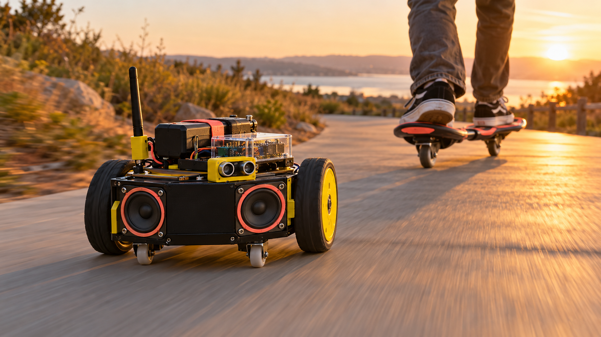

# FollowTune
### By Ridith Shetty

FollowTune is a custom robot car that actively tracks your moving Ripstik using dual IR sensors, a laser center-lock, and sweeping obstacle avoidance. It doubles as a kinetic motion synth that turns your carving sways into live audio when Bluetooth is disconnected. You can also stream music directly using Bluetooth.

---

## Overview

FollowTune is an autonomous mobile tracking platform designed to follow a rider on a Ripstik or caster board. By pairing an active transmitter mounted underneath the board with a differential-drive robot car behind it, the system maintains target tracking through a combination of infrared beaconing, optical laser alignment, and dynamic steering calculations. When active tracking is paused or Bluetooth audio is disconnected, the car converts your physical carving sways directly into synthesized audio output through an onboard speaker.

---

## Core Features

* **Active IR Tracking:** The robot uses multiple infrared receivers to read modulated signals emitted from the transmitter beacon. It compares signal strength across sensors to calculate real-time steering corrections.
* **Laser Center-Lock Alignment:** A focused laser module on the board targets a light-dependent sensor on the car. Detecting the laser beam confirms dead-center alignment, allowing the bot to boost forward speed along straight paths.
* **Sweeping Obstacle Avoidance:** An ultrasonic distance sensor mounted on a micro servo continuously sweeps left and right to monitor the path ahead. If an obstacle comes within range, the robot pauses tracking, executes an evasion routine, and scans for a clear alternative route.
* **Kinetic Motion Synthesizer (Theremin Mode):** When Bluetooth is disconnected, the robot translates physical carving angles into real-time audio frequencies. Swerving left or right alters the tone pitch, while laser contact triggers higher frequency accents.
* **Bluetooth Audio Playback:** Pairs with mobile devices to stream music or sound effects directly through an integrated audio amplifier and speaker setup during standard operation.

---

## System Mechanism & Architecture

### 1. Transmitter Beacon (Ripstik Side)
* **Power Source:** Powered by a compact rechargeable battery pack mounted under the board.
* **Signal Modulation:** Uses a timer circuit to pulse infrared LEDs, preventing ambient room light or outdoor sunlight from interfering with tracking.
* **Optical Beacon & Laser Assembly:** Fires three infrared emitters in a wide fan pattern to cover carving angles, alongside an active centered laser beam module pointing straight back at the robot to establish lock-on tracking.

### 2. Receiver & Drivetrain (Robot Side)
* **Perception Array:** Features left, center, and right infrared receivers alongside a center-mounted light sensor to detect both broad signals and narrow laser hits.
* **Safety Processing:** A micro servo pans the ultrasonic sensor across left, forward, and right angles to evaluate spatial clearance before moving forward.
* **Proportional Steering Control:** Uses differential motor speed mapping to slow down inner wheels and accelerate outer wheels, creating smooth carving maneuvers that match the motion of the Ripstik.
* **Audio System:** Features an onboard amplifier board connected to a mini speaker driver for both synth tone generation and Bluetooth streaming.

---

## Operational Modes

| Mode | Trigger Condition | Robot Action | Audio Behavior |
| :--- | :--- | :--- | :--- |
| **Active Tracking** | Bluetooth Connected + Path Clear | Calculates directional error and follows Ripstik using proportional motor control | Streams wireless Bluetooth audio |
| **Kinetic Synth** | Bluetooth Disconnected + Path Clear | Tracks Ripstik movements while calculating sway differentials | Converts carving angles into dynamic synth frequencies |
| **Obstacle Evasion** | Ultrasonic Sensor Clearance Warning | Halts forward motion, backs up, and scans left/right for open paths | Emits a short hazard warning tone |

